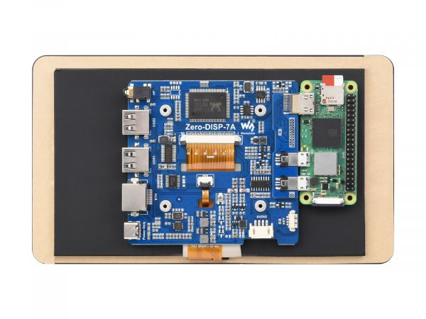
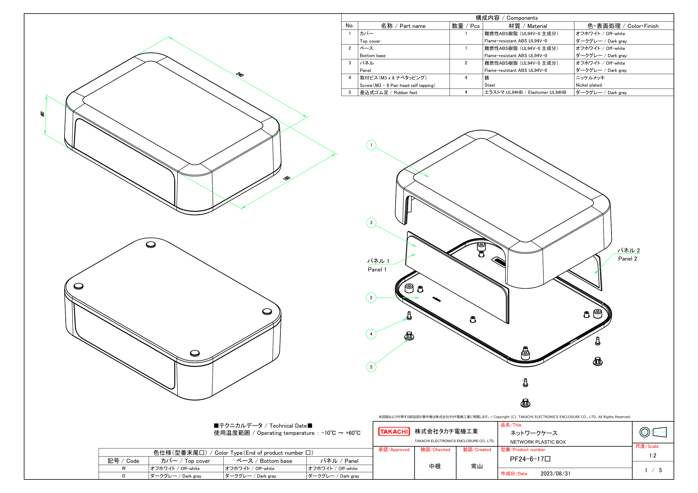
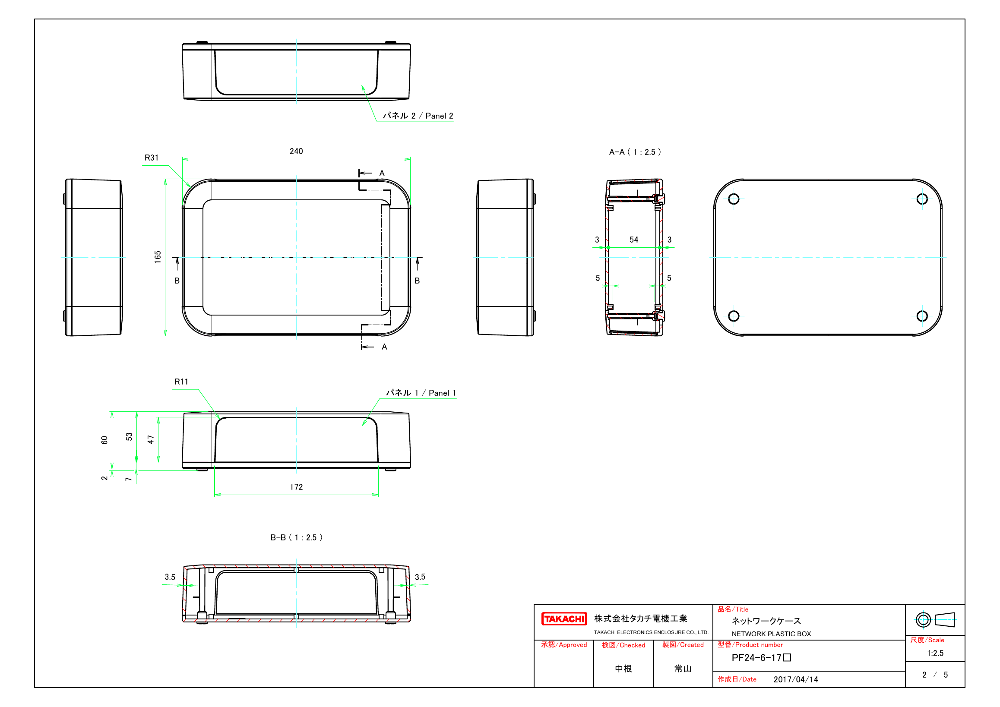
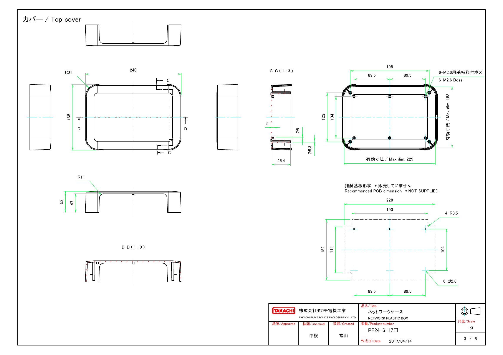
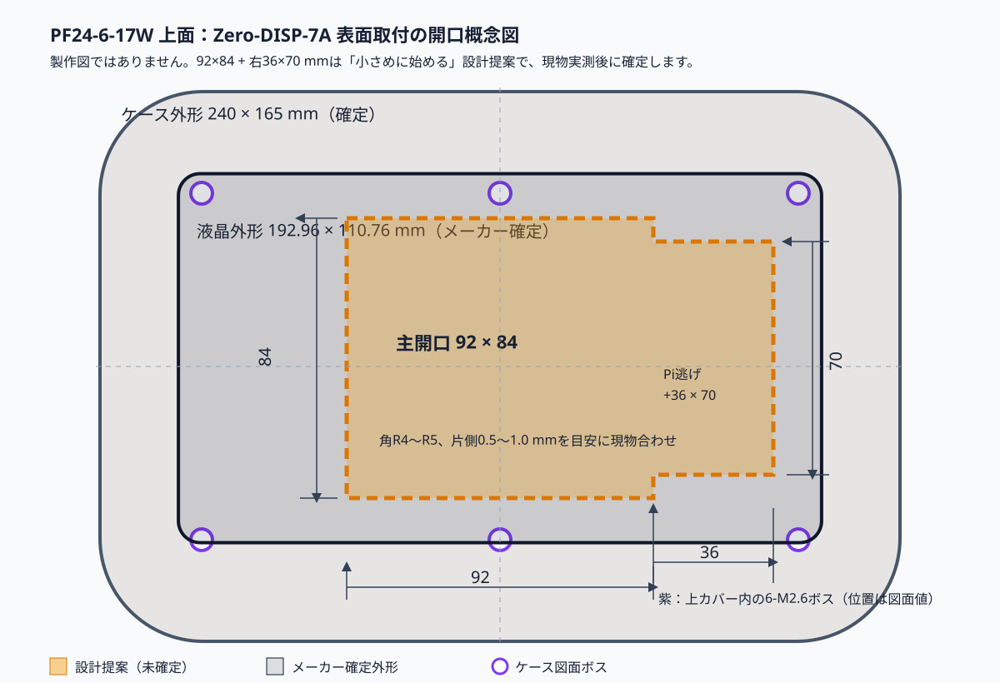
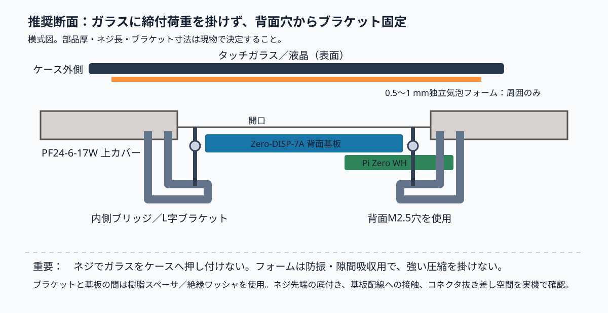

# TC106：Zero-DISP-7AをPF24-6-17Wへ表面取付する検討

作成日：2026-11-09  
対象：Waveshare Zero-DISP-7A + Raspberry Pi Zero WH / タカチ PF24-6-17W  
目的：7インチ表示器をケース上面へ表面取付し、背面基板とPi Zero WHをケース内へ収める。

> **結論**  
> 表面取付は寸法上可能性が高い。液晶ガラス全体を通す大穴ではなく、背面基板用の主開口に、Pi Zero WH側だけを広げた段付き開口が適する。  
> ただし、**加工寸法はまだ確定していない**。下記の92×84 mm主開口 + 右側36×70 mmは、小さく切って現物合わせするための開始案であり、実測値を得るまで製作図として使わないこと。

## 1. 参照資料

- タカチ公式図面：[`sources/PF24-6-17W.pdf`](sources/PF24-6-17W.pdf)
- 支給STEP：[`sources/zero-disp-7a.stp`](sources/zero-disp-7a.stp)
- 支給写真（原本）：[`sources/Zero-DISP-7A10_original.jpg`](sources/Zero-DISP-7A10_original.jpg)
- [Waveshare Zero-DISP-7A 公式Wiki](https://www.waveshare.com/wiki/Zero-DISP-7A)
- [Raspberry Pi Zero公式ドキュメント](https://www.raspberrypi.com/documentation/computers/zero.html)
- [Raspberry Pi Zero公式メカ図](https://datasheets.raspberrypi.com/rpizero/raspberry-pi-zero-mechanical-drawing.pdf)

写真では、青いZero-DISP-7A基板の右側へPi Zero WHが張り出す。左側にはRJ45、USB、音声などのコネクタ、下側にはフラットケーブルがある。この向きを以下の図でも「Pi側 = 右」とする。

## 2. 寸法の確定度

### 2.1 メーカー資料で確定

| 対象 | 寸法・仕様 | 根拠 |
|---|---:|---|
| PF24-6-17W 外形 | 240 × 60 × 165 mm | タカチ図面 p.1～2 |
| ケース内高さ | 47 mm | タカチ図面 p.2 |
| 上カバー内の有効寸法 | 最大229 × 153 mm | タカチ図面 p.3 |
| 上カバーの基板取付ボス | 6-M2.6、横89.5 + 89.5 mm、縦104 mm | タカチ図面 p.3 |
| ケース材質 | 難燃性ABS（UL94V-0主成分） | タカチ図面 p.1 |
| Zero-DISP-7A外形 | 192.96 × 110.76 × 17.00 mm | Waveshare公式Wiki |
| 表示領域 | 154.88 × 86.72 mm | Waveshare公式Wiki |
| 表示器背面の固定穴 | M2.5、4か所 | Waveshare公式Wiki FAQ |
| Pi Zero W/WH基板外形 | 約65 × 30 mm | Raspberry Pi公式資料 |
| Pi Zero取付穴 | 58 × 23 mm配置、4-Ø2.75（M2.5用） | Raspberry Pi公式メカ図 |

ケース全体と構造：

外形と断面：

上カバー内ボス：

### 2.2 支給STEPから得たCAD公称値

前段のSTEP確認で得た値。メーカーの加工公差を示す値ではない。

| 対象 | CAD公称値 | 扱い |
|---|---:|---|
| 背面の板状部分の外形 | 約86.7 × 80.3 mm | 開口開始案の基準。現物測定で照合する |
| 背面固定部の中心間隔 | 約50 × 50 mm | ブラケット設計の参考。穴中心は現物で採寸する |

### 2.3 写真からの推定値 - 加工に使用禁止

表示器外形を尺度にした写真上の概算では、Pi装着後の背面占有範囲は**およそ126 × 95 mm**に見える。撮影遠近、部品の高さ、輪郭の読み方で誤差が出るため、これは「右側と上下方向の確認が必要」と示すだけの値である。

### 2.4 未確定 - 加工前に必ず実測

1. Pi Zero WH装着状態の最大投影外形：基板、GPIOヘッダー、コネクタ、はんだ端を含む。
2. 最大投影外形と液晶ガラス四辺とのオフセット。
3. ガラス背面から最も高い部品までの高さ。Pi、GPIO、ケーブルの曲げも含む。
4. Zero-DISP-7Aの4-M2.5穴の正確な穴中心位置、穴深さ／ねじ仕様。
5. RJ45、USB、音声、USB Type-C、microSD等を抜き差しするための指・プラグ・曲げ半径の空間。
6. ケース上面の実肉厚、成形リブ、ボス外径。図面値だけでなく手元のケースで確認する。
7. 表示器を置く最終位置。ケースの外周R部、傾斜、上面の平坦範囲との関係。

## 3. 開口案

### 推奨する開始形状（設計提案・未確定）

- 主開口：**92 × 84 mm**、角R4～R5。
- Pi側の逃げ：主開口の右辺からさらに**36 mm**、高さ**70 mm**。
- 最大幅：128 mm。ただしPi側の実測張り出しが小さければ、右の逃げ幅も小さくする。
- 部品と切断縁の目標クリアランス：通常は片側0.5～1.0 mmから開始し、組立性と振動を見て調整する。
- 切断縁から液晶外縁までの重なり、および切断縁からボス外周までの残り肉は、**最低5 mmを目標**にする。

この形なら、Piの長辺65 mmに対して70 mmの逃げを置き、主開口をCAD公称86.7 × 80.3 mmより小幅に余裕を持たせられる。ケース中央を基準にした概念配置では6個のM2.6ボスを避けやすい。ただし実際の表示器内オフセット次第で変わるため、ボスを残せることは確定ではない。

> **加工寸法の決め方**  
> `開口輪郭 = 組立状態の最大投影輪郭 + 片側0.5～1.0 mm` を基本とする。左右非対称なので、幅と高さだけでなく、液晶外縁を原点に各辺までの距離を測る。

### 実測記録欄

| 記号 | 測定箇所 | 実測値 |
|---|---|---:|
| A | ガラス左端 → 背面占有範囲左端 | ____ mm |
| B | ガラス上端 → 背面占有範囲上端 | ____ mm |
| C | 背面占有範囲の総幅（Piを含む） | ____ mm |
| D | 背面占有範囲の総高さ | ____ mm |
| E | ガラス背面 → 最大高さ | ____ mm |
| F | Pi側張り出し幅 | ____ mm |
| G | 必要なコネクタ抜き差し空間 | ____ mm |

厚紙または1 mm程度の捨て板に実測輪郭を写し、表示器を通してからケースへ転記する。SVG図をそのまま1:1印刷して加工テンプレートにしてはいけない。

## 4. 取付案

### A案：背面M2.5穴 + 内側ブリッジ／L字ブラケット（推奨）

1. 液晶ガラスをケース外側へ置き、背面基板だけを開口へ通す。
2. ガラス外周とケースの間に0.5～1.0 mm程度の独立気泡フォームを置く。目的は隙間吸収と防振であり、強く圧縮しない。
3. 表示器背面4-M2.5穴へ樹脂スペーサと小型L字金具、または3Dプリント製フレームを取り付ける。
4. ケース内側のブリッジへ固定し、荷重をケースの広い範囲へ分散する。
5. ネジ長は現物で決める。底付き、基板への接触、ガラスへの押圧が起きないことを確認する。

利点：保守時に取り外せ、ガラスへの集中荷重を避けやすい。  
注意：ブラケットがPi、GPIO、フラットケーブル、コネクタに干渉しない形にする。

### B案：内側クランプフレーム

開口より大きい内側フレームで表示器外周を保持する。ネジはフレーム同士を締結し、ガラスを直接点で押さえない。加工誤差を吸収しやすいが、フレーム設計と部品高さの検討が必要。

### C案：両面テープ併用

薄手の工業用アクリルフォームを外周へ使えば防塵と位置決めに有効。ただし、テープのみを恒久固定にすると、熱、経年、再作業、剥離時のガラス破損が問題になる。A案またはB案の機械保持を主とし、テープは補助にする。

## 5. 加工手順

### 5.1 準備

1. **ケースから電子部品をすべて外す。** 表示器を装着したまま切削しない。
2. 現物をノギスで測り、上の実測欄を埋める。
3. ケース上面の平坦部、内側リブ、6ボス、ケース締結部を確認する。
4. 厚紙テンプレートを作り、表示器とケース双方に当てて位置を確認する。
5. ケース表面へ養生テープを貼り、基準線、開口線、穴中心を細線で記す。
6. 切りくずの出口側に捨て木を密着させ、ケースを平らにクランプする。クランプでケースを変形させない。

### 5.2 BLACK+DECKER KS701PEでの切断

1. 保護メガネを着用し、長い髪・袖・手袋を刃の近くへ持ち込まない。粉じんを吸わないよう換気・集じんを行う。
2. 細目の樹脂／金属兼用ブレードを使う。オービタルは0、低～中速から試す。
3. 角R部の内側に、刃が入る大きさのスターター穴を開ける。穴は仕上げ線の内側に置く。
4. **線の0.5～1.0 mm内側**を切る。最終寸法はヤスリで出す。
5. 刃を無理に曲げず、ベースをケースへ密着させる。ABSが溶けて再溶着する場合は速度を落とし、休止して冷ます。
6. まず主開口を小さめに切り、Pi側の逃げは現物を当てながら段階的に広げる。
7. 半丸ヤスリ、平ヤスリ、スクレーパーで仕上げる。角はRを残し、亀裂起点となる鋭い内角を作らない。

### 5.3 洗浄と仮組み

1. バリと切りくずを完全に除去する。掃除機と柔らかい刷毛を使い、必要ならケース単体を洗浄して完全乾燥させる。
2. 切断縁へ薄い紙を滑らせ、引っ掛かりがないことを確認する。
3. 表示器を無理なく通し、全周クリアランス、ボス、ブラケット、ケーブルを確認する。
4. コネクタを実際に抜き差しし、プラグ胴、指、ケーブル曲げ半径が確保できるか確認する。
5. ブラケットを仮締めし、画面表示とタッチを試す。画面の色むらやタッチ誤動作が出たら押圧を緩める。

## 6. 安全・信頼性上の注意

- 電源、USB、HDMI、LANをすべて外して作業する。
- ジグソーの刃交換、切りくず除去、位置調整は電源プラグを抜いて行う。
- ケースを手で持ったまま切らない。安定した作業台へ固定する。
- ガラスをクランプしたり、ネジ頭や金具で点押ししたりしない。強化ガラスでも端面傷と局所荷重に弱い。
- 切断縁と基板・はんだ面の間に絶縁性の縁材または十分な空間を設ける。
- 金属ブラケットは基板配線から絶縁し、緩み止めを使う。導電性の切りくずをケース内へ残さない。
- USB給電はWaveshare指定条件を満たす電源を使い、発熱部とフォーム材を密着させない。
- このケースの難燃性は、開口追加後の製品全体の安全規格適合を保証しない。公共設備や無人運転に使う場合は、温度上昇、難燃、感電、ケーブル保持を別途評価する。

## 7. 加工前チェックリスト

- [ ] A～Gの現物寸法を測った
- [ ] 厚紙テンプレートに組立品が無理なく通る
- [ ] 液晶外縁の重なりと、切断縁周囲の残り肉を確認した
- [ ] 6-M2.6ボスを残す／除去する判断をした
- [ ] 4-M2.5穴の位置・深さ・使用ネジ長を現物確認した
- [ ] コネクタとmicroSDのサービス空間を確認した
- [ ] ブラケットがPi、GPIO、FPCへ干渉しない
- [ ] 電子部品を外し、ケースだけを固定した
- [ ] 保護メガネ、集じん、捨て木、細目刃を準備した
- [ ] 小さめに切り、ヤスリで仕上げる手順にした

## 8. 最終判断

PF24-6-17Wの上面240 × 165 mmに対し、Zero-DISP-7Aは192.96 × 110.76 mmなので、外周の支持余地はある。段付き開口にすればPi側だけを逃がし、ケース材を多く残せる。最も大きい不確定要素は、**Pi装着後の投影輪郭と表示器外縁からのオフセット**である。したがって、最終開口寸法は写真推定ではなく、組立状態をノギスで測った後に確定する。

